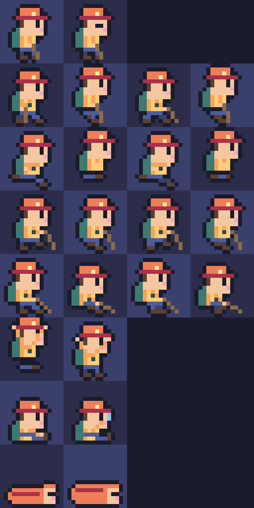
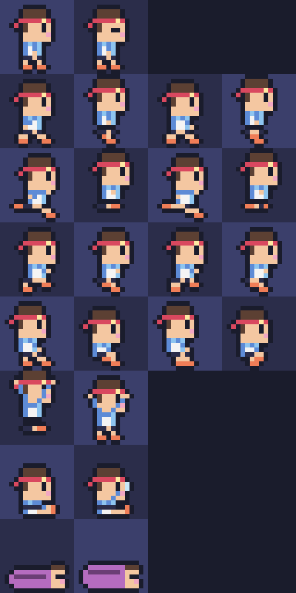
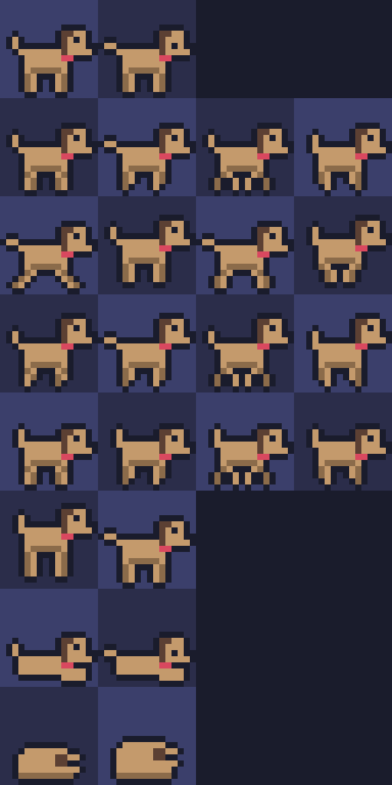
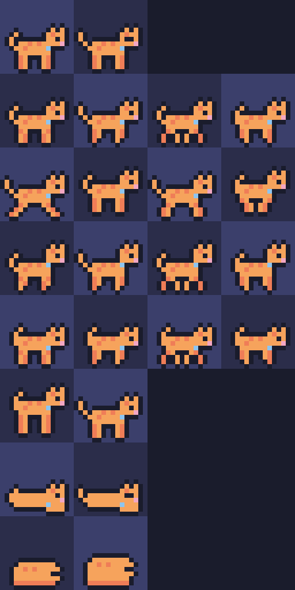
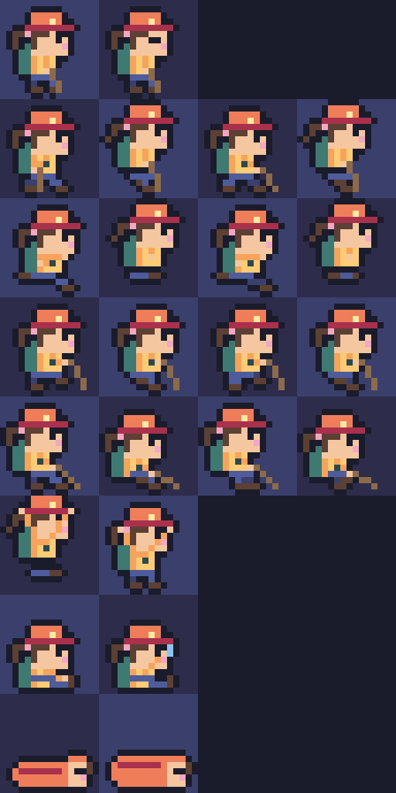
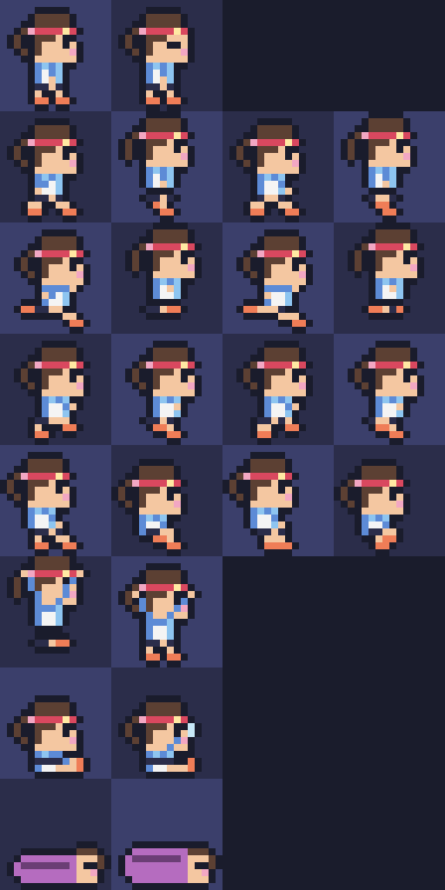
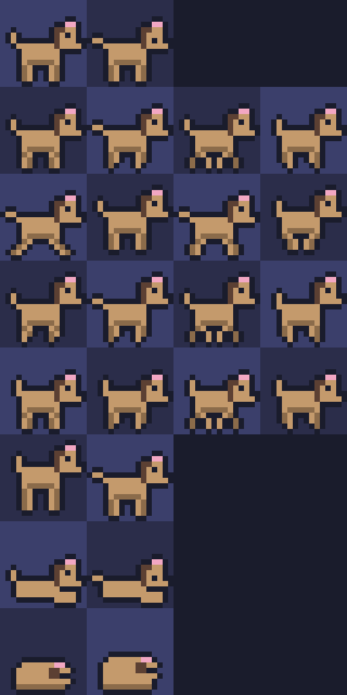
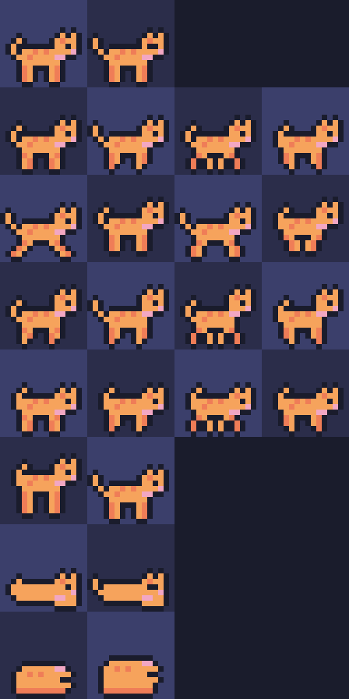
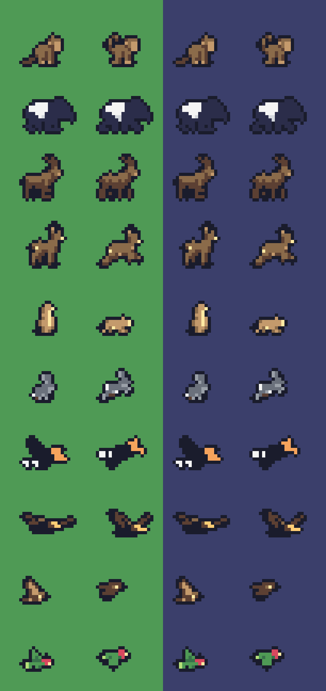
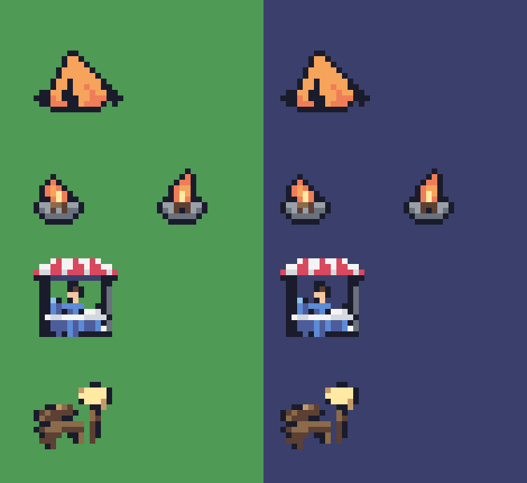

# Pixel Hike sprite standard (v1)

One fixed format for every character, so art from Grok Imagine (or anywhere else) can be dropped in
without code changes. The built-in Hiker, Runner, Dog and Cat in [`src/characters.ts`](../src/characters.ts)
follow it exactly. Their sheets are in [`docs/sprites/`](sprites/).

| | Hiker | Runner | Dog | Cat |
|---|---|---|---|---|
| **Male** |  |  |  |  |
| **Female** |  |  |  |  |

Male and female versions share the same outfit and the same layout. Female people get a fringe, an eyelash pixel and a ponytail
that sticks out *above* the backpack (so it still reads at 16 px); female pets get a pink bow. A custom sheet replaces whichever
version is selected.

## The rules

1. **Frame:** 16 × 16 px.
2. **Facing right.** The app mirrors the frame when the character walks left.
3. **Anchor:** bottom-centre (x = 8). Feet (or paws) touch the bottom edge, so the bottom row holds the outline under the feet.
4. **Outline:** 1 px, colour `#1a1c2c` (`ink`), outside the shape.
5. **Colours:** only the 32-colour palette below ([`palette.hex`](palette.hex) / [`palette.json`](palette.json)). Background fully transparent (alpha is snapped to 0/255 on load).
6. **Sheet:** 4 columns × 8 rows = **64 × 128 px**, one animation per row, frames left → right.
   An exact integer upscale is also accepted (e.g. 512 × 1024 at 8×).
7. **Missing frames:** leave the cell transparent. The app falls back to the built-in frame for that cell.
8. **Head-lamp pixel** (people only): the built-in hiker has it at (8, 3) and the runner at (9, 4). The night glow sparkles there.

## Animation rows

| Row | Name | Frames | FPS | Used when | Pose notes |
|---|---|---|---|---|---|
| 0 | `idle` | 2 | 2 | Intro, viewpoints | Standing; frame 2 = blink |
| 1 | `walk` | 4 | 6 | Hiking on flat / gentle ground | contact → passing (body 1 px up) → contact (legs swapped) → passing |
| 2 | `run` | 4 | 10 | Trail run activity | Lean forward 1 px, longer stride, frames 2 & 4 in the air (body 1 px up) |
| 3 | `climb` | 4 | 5 | Grade > 15 % uphill | Lean forward, short steps, front foot lifted, pole planted ahead |
| 4 | `descend` | 4 | 6 | Grade < −15 % (hike / camp hike) | Lean back, short careful steps, pole ahead and low |
| 5 | `cheer` | 2 | 5 | Summit, peaks, finish, outro | Frame 1: jump (2 px up) with arms up; frame 2: landed, arms up |
| 6 | `rest` | 2 | 1.5 | Rest stops, aid stations, camp in daylight | Sitting; frame 2 = drinking |
| 7 | `sleep` | 2 | 1 | Camp at night | Lying (sleeping bag / curled up); frame 2 = breathing |

Pets use the same rows: `rest` = lying with head up, `sleep` = curled up, `cheer` = hop with the tail up.

## Palette

| name | hex | name | hex | name | hex | name | hex |
|---|---|---|---|---|---|---|---|
| ink | `#1a1c2c` | yellow | `#ffcd75` | forestDeep | `#2e5a3a` | brown | `#8b6b4a` |
| ink2 | `#2b2d4a` | cream | `#ffe9a3` | forest | `#38714a` | brownDark | `#5c4033` |
| night | `#3b3f6b` | orange | `#f6a35c` | green | `#4f9a55` | tan | `#c49a6c` |
| dusk | `#4d5d9b` | coral | `#ef7d57` | greenLight | `#7cc26b` | rock | `#9aa0a8` |
| sky | `#5d8bd6` | red | `#d9485f` | lime | `#b5e07a` | rockDark | `#6b717c` |
| skyLight | `#8ec5f0` | wine | `#a8324b` | tealDeep | `#2a4a4f` | greyLight | `#d5d9de` |
| skyPale | `#c7e8f7` | pink | `#f2a7c3` | moss | `#3e7a72` | skin | `#f4c7a1` |
| white | `#f4f4f4` | purple | `#b56cbf` | sage | `#6aa69a` | plum | `#6b3e75` |

## Making a character with Grok Imagine + unfake.js

Image models are bad at exact grids, so make **one frame per image** and assemble the sheet afterwards.

1. **Lock the character first.** Generate a single reference pose and keep re-using it as the image reference so every frame is the same character:

   > Pixel art game sprite, 16×16 pixels, side view facing right, chibi hiker with a coral bucket hat, yellow t-shirt, teal backpack, blue trousers, brown boots, holding a trekking pole. Thick 1-pixel dark navy outline, flat colours, no anti-aliasing, no shading gradients, transparent background, centred, feet touching the bottom edge. Limited palette.

   For a female version add e.g. *"dark brown ponytail sticking out behind the hat, short fringe"* — keep everything else identical so both sheets match.

2. **One prompt per frame,** same reference image, changing only the pose line, for example:
   - `walk 1/4: mid-stride, front leg forward, back leg back, arm swinging back`
   - `climb 2/4: leaning forward up a steep slope, short step, pole planted ahead`
   - `cheer 1/4: jumping with both arms up, celebrating`
   - `sleep 1/2: lying in a coral sleeping bag, eyes closed`
   - pets: `cute small tan dog with floppy ear and red bandana, side view facing right, trotting`

3. **Clean each frame with [unfake.js](https://github.com/jenissimo/unfake.js)** (browser tool or `processImage`):
   - `manualScale`: image size ÷ 16 (e.g. 1024 px → `64`), or `detectMethod: 'auto'` if the art already looks gridded
   - `downscaleMethod: 'dominant'`, `snapGrid: true`
   - `fixedPalette`: the 32 colours from `docs/palette.json`, so it matches the scene exactly
   - `cleanup: { morph: true, jaggy: true }`, alpha binarisation on
4. **Assemble** the 16×16 PNGs into the 64×128 grid (rows/columns as above). Use **Template PNG** in the app as the
   starting canvas: it downloads the current character's sheet at 8×, so you can paint over it.
5. Load it with **Use my sprite sheet…** in the Character panel.

## Wildlife and props from Grok Imagine

The animals (hornbill, macaques, tapir, parrots, marmot, ibex, golden eagle, deer, rabbit, hawk) and the
2D-map props (camp tent + campfire, aid station, rest bench) are Grok Imagine art, turned into exact
palette sprites by [`scripts/grok-sprites.mjs`](../scripts/grok-sprites.mjs):

- Sources: `art/grok/wild/*.jpg` and `art/grok/props/*.jpg` — 2 frames side by side (or stacked) on a flat
  magenta background. Settings per sprite in `art/grok/<group>/sprites.json` (target height, allowed
  colours, `remap`, `fill`, anchor; see the script header).
- `node scripts/grok-sprites.mjs wild` → `src/wildart.ts` (+ `docs/sprites/wild-preview.png`);
  `node scripts/grok-sprites.mjs props` → `src/propsart.ts`. Both are char maps like the hand-made sprites,
  so flipping, fades and night tints work unchanged; the hand-made frames stay as fallbacks.
- Prompt pattern that works: *"Pixel art sprite sheet for a retro 16-bit game: two animation frames side
  by side of a <animal>, full body side view, both frames facing right. <colours>. Frame 1: <pose>.
  Frame 2: <pose>. Each frame is a 16x16 pixel sprite scaled up with big crisp square pixels, 1-pixel dark
  navy outline, flat colours, no anti-aliasing, no gradients, no shading, no ground, no shadow, no text.
  Solid flat magenta background (#FF00FF)."* Say "no rocks / no grass" or Grok adds a base.

## Character pack (your own character, from a photo)

The standard sprite is 16 px — too small for a likeness. A **character pack** is your character in two
sizes, in one PNG: *Character → Character pack…* (saved with the track's edits). It replaces the character
everywhere: about **28 px** on the trail (2D and 3D — in 3D it's drawn crisp on top, with its shadow in the
scene) and about **64 px** in the start / finish arch scenes (the countdown and FINISHER! move up above the
arch) and on the poster. Its colours are used as they are, not snapped to the 32-colour palette.

- **Layout:** 320 px wide, rows in the standard order (idle, walk, run, climb, descend, cheer, rest, sleep),
  up to 4 frames per row, facing right, feet on each cell's bottom edge, centred, empty cells left out.
  y 0–640: big frames in 80 × 80 cells; y 640–960: trail frames in 40 × 40 cells (left half). So 320 × 960
  (or 320 × 640 for close-ups only), or an exact integer upscale. A missing row borrows a near one
  (climb → walk, sleep → rest…). The head-lamp pixel is found automatically (brightest warm pixel up top).
- **Making one with Grok Imagine:** crop the photo to just you, paste it into Imagine with *"this runner as a
  pixel art game character, two frames side by side, full body side view facing right: standing idle /
  running, cute chibi proportions, <your kit>, 1-pixel dark navy outline, flat colours, solid flat magenta
  background"*. Then edit that result once per animation — *"same character… walking: contact / passing"*,
  *"…up a steep slope"*, *"…down a steep slope, arms out for balance"*, *"…sitting resting / drinking"*,
  *"…asleep in a sleeping bag, head on the right"*, *"…jumping with both arms raised / landed, arms up"* —
  always asking for *"no ground, no rock"* so nothing is drawn under you.
- **Converting:** put the downloads in `art/grok/me/` (git-ignored — it's your likeness) with a
  `sprites.json`: per image its `rows` and a `cell` (source px per big-sprite px; ~15.5 gives 64 px — use a
  smaller one if Grok drew that pose smaller, as it did for sleeping), plus `"alignY": "shared"`,
  `"palette": false`, `"sample": "centre"`, `"outline": false`; lower `bgThreshold` if a colour close to the
  background (a coral sleeping bag on pink) gets cut out. Then
  `node scripts/grok-sprites.mjs me --big art/grok/me/pack.png`. The trail frames are made from the same
  images at `cell × 2.35` with a majority vote, an ink outline and a rule that keeps small dark details
  (eyes) — `trailScale`, `trailDetail` tune it.

## Props still drawn in code

| Prop | Size | Notes |
|---|---|---|
| Flag (start, summit, peak, viewpoint, finish) | 8 × 16 | Raised when reached; finish is checkered |
| Aid-station canopy without the volunteer (signs off) | 11 × 7 | Striped roof |
| Summit signboard | text | Name + height are typed in, so it stays code-drawn |
| Sun | 7 × 7 | HUD dial and sky |
| Moon | 7 × 7 | Drawn in code with the real moon phase |
